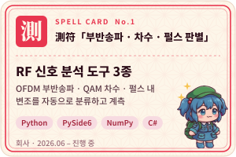
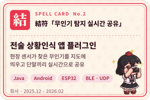
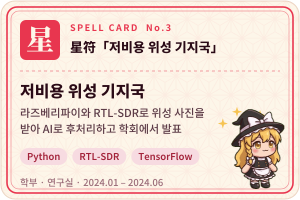

## ⛩️ 어서 오세요!

신호를 **측정하고**, 장비를 **붙이고**, 현장에서 **쓰이게** 만듭니다.

- 📡 RF 신호 분석 도구와 전술 상황인식 앱 플러그인을 만들고 있어요.
- 🔍 문서가 없는 장비와 파일 포맷은 실험으로 하나씩 밝혀서 붙이고, 고친 건 숫자로 확인한 뒤에 반영해요.
- 🗂️ 지금까지 한 프로젝트 17개는 <b><a href="https://19ygh.netlify.app">포트폴리오</a></b>에 정리해 뒀어요.

## 🎴 Spell Card — 대표 프로젝트

  
  
  

카드를 누르면 포트폴리오의 상세 페이지로 가요. 회사 작업은 제품명과 세부 사양을 빼고 적었습니다.

## 🗺️ Stage Select — 걸어온 길

| Stage | 무대 | 시기 | 클리어한 프로젝트 |
| :-: | :-- | :-- | :-- |
| **1** | 🎓 학부 | 2023 | [AWNAS](https://github.com/JunYBae/Army_Wireless_Network_Attack_System) — 아두이노 무인 지상 차량과 무선 네트워크 공격 시스템 |
| **2** | 🔬 연구실 | 2023–24 | VR 의학 교육 다중접속 · NFC 생체 센서 앱 · 저비용 위성 기지국 (KICS 2024 발표) |
| **3** | 🏫 SSAFY | 2025 | [NestQuest](https://github.com/19GHYun/NestQuest) · Yolo Bring it · [신한 해커톤 공동구매](https://github.com/2025SinhanHackaton/GongGuYoung) · [Plate-Pay](https://github.com/19GHYun/juchajang) |
| **4** | 🛡️ 회사 | 2025 – | 전술 상황인식 앱 플러그인 · RF 신호 분석 도구 3종 |
| **Extra** | 🎐 개인 | 2021 – | 개인 프로젝트는 <a href="https://19ygh.netlify.app">포트폴리오</a>에서 |

## 🧰 Items — 다뤄 본 기술

| 분류 | 아이템 |
| :-- | :-- |
| 💬 **언어** |   |
| 📡 **신호 · 임베디드** |        |
| 🖥️ **화면 · 클라이언트** |  |
| ⚙️ **백엔드 · 인프라** |  |
| 🧠 **AI · 데이터** |  |

## 🏆 Rank — 백준 · solved.ac

  

## 📊 Status

  

캐릭터와 신사 그림: <a href="https://github.com/19GHYun/hokora-shrine">Hokora</a> 스프라이트

 

